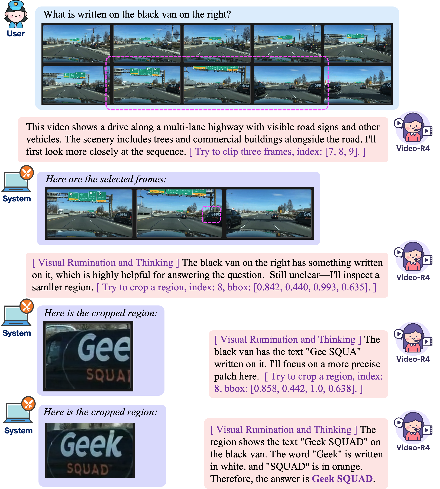
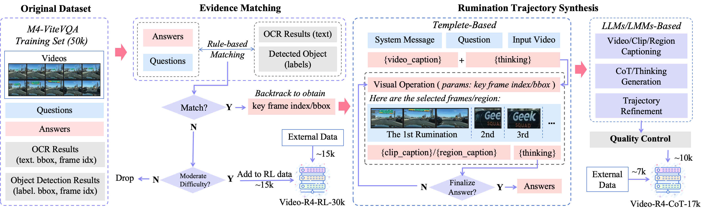
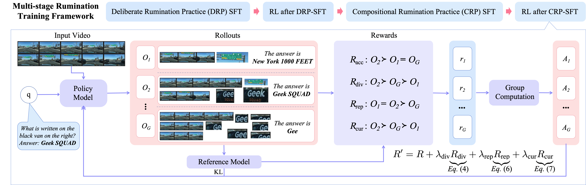
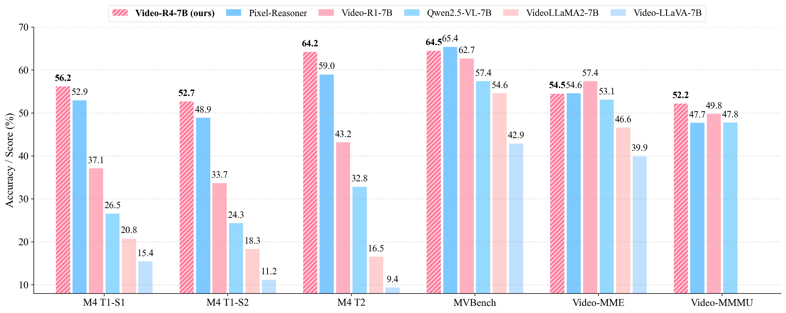

# Video-R4: Reinforcing Text-Rich Video Reasoning with Visual Rumination

> *[Yolo Yunlong Tang](https://yunlong10.github.io/)1,  [Daiki Shimada](https://scholar.google.com/citations?user=1uAwouQAAAAJ&hl=en)2, [Hang Hua](https://hanghuacs.notion.site/)3, [Chao Huang](https://wikichao.github.io/)1, [Jing Bi](https://jing.vision/)1, [Rogerio Feris](https://www.rogerioferis.org/)3, [Chenliang Xu](https://www.cs.rochester.edu/u/cxu22/)1*

> *1University of Rochester, 2Sony Group Corporation, 3MIT-IBM Watson AI Lab*

### Video-R4

### Data Curation Pipeline

### Video-R4 Training Framework

### Performance
